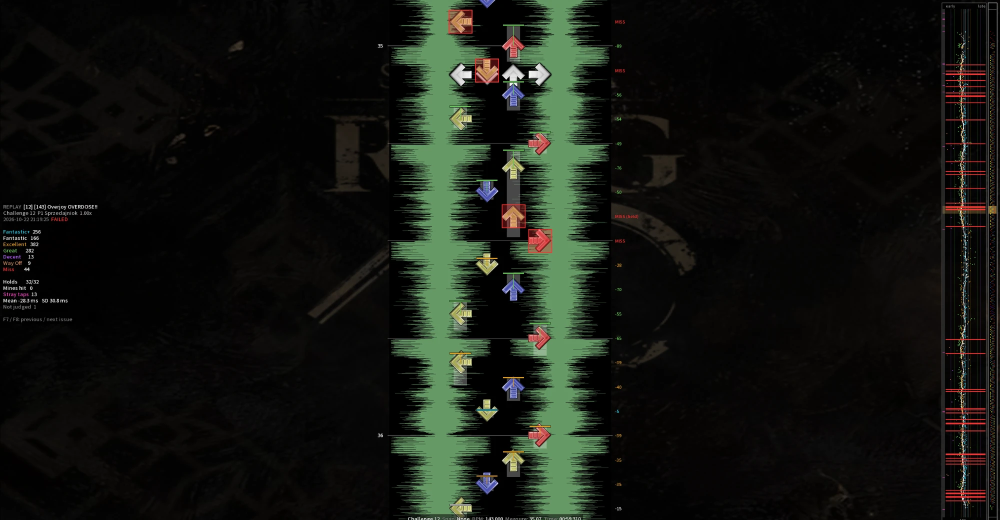
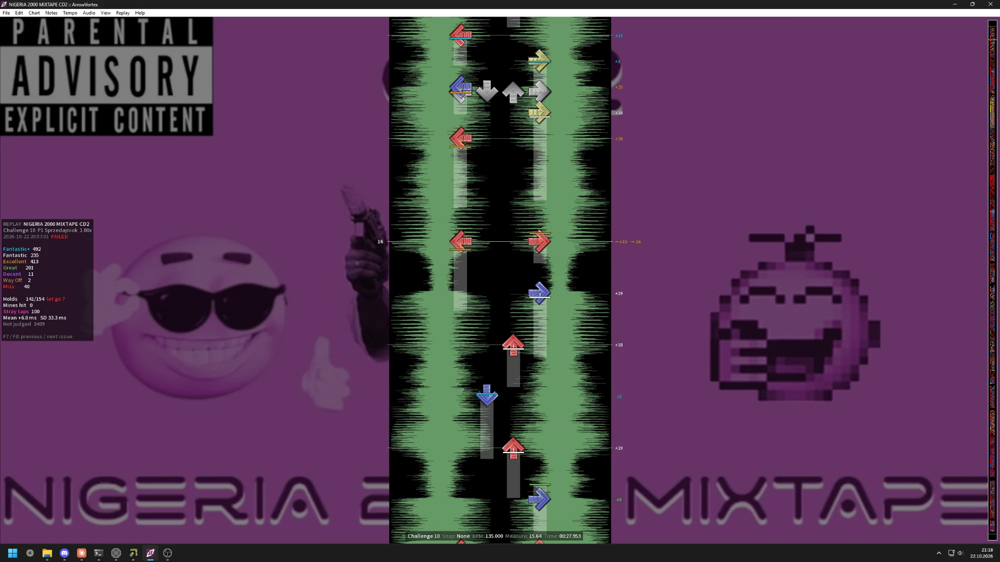
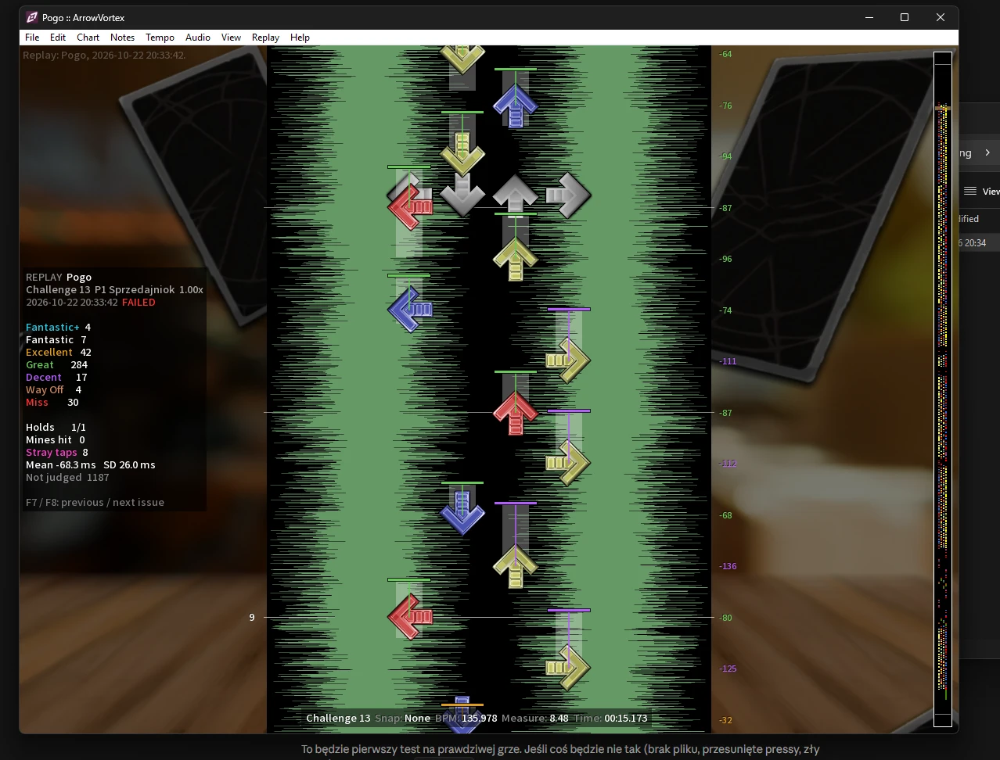
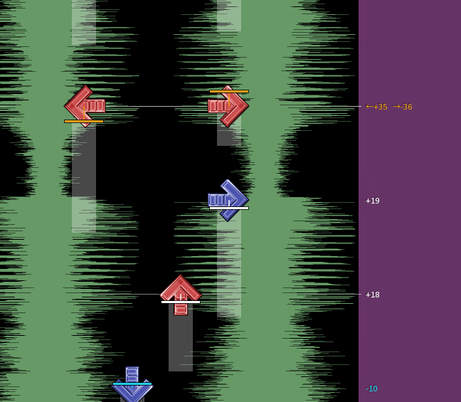

# ArrowVortex + ArrowReplay

This fork of [ArrowVortex](https://github.com/uvcat7/ArrowVortex) adds
**ArrowReplay**, a replay viewer for ITGmania. A Simply Love module records
your plays, and ArrowVortex lets you scroll through them on the chart: the
timing of every note, every panel press (including presses that hit nothing),
misses, dropped holds and hit mines.



- [What it shows](#what-it-shows)
- [Installing](#installing)
- [Using it](#using-it)
- [How it works](#how-it-works)
- [Building from source](#building-from-source)
- [ArrowVortex](#arrowvortex) (the original README)

## What it shows

| | |
| --- | --- |
|  |  |
| The summary panel on the left, each note's offset to the right of the notefield, how long each panel was held as light strips. | Every press is a bar in its judgment color with a line to the note it hit, so early and late hits are visible at a glance. |



| Mark | Meaning |
| --- | --- |
| Colored bar with a line to the note | The press that hit the note, in the judgment color (blue FA+, white Fantastic, gold Excellent, green Great, purple Decent, brown Way Off) |
| Bar with a dashed line to the note, label `fixed from Decent -113` | An early decent/way off that a later press fixed (ITGmania's early hit rescoring) |
| Thick pink bar, `stray` | A press that did not activate anything |
| Gray bar | A press during a hold or roll |
| Red box, `MISS` | A miss (`MISS (held)` if the panel was held down) |
| Red bar, `LET GO` | Where the foot left a dropped hold |
| Red box on a mine, `MINE` | A hit mine |
| Light strips behind the notes | How long each panel was held down |

Offsets are in milliseconds, negative is early. Jumps show one value per arrow.

**Summary panel** (left): judgment counts, holds, hit mines, stray taps, early
hits and how many of them were fixed, mean offset and standard deviation.

**Timeline** (next to the minimap, same vertical scale): every note as a dot
at its offset (early left, late right), window edges as thin lines, the mean of
the last 24 hits as a white trail, misses as red lines, dropped holds as orange
lines, hit mines as short red marks on the right and stray taps as pink marks
on the left. A fixed early hit shows its early dot joined to the final one. The yellow box is the part of the chart on screen; click or drag
to jump.

## Installing

Download `ArrowReplay-v0.1.0-win64.zip` from
[Releases](https://github.com/Sprzedajniok/ArrowVortex/releases) and unzip it.

1. **Recorder:** copy `Simply Love module/ArrowReplay.lua` into the `Modules`
   folder of your Simply Love theme, e.g.
   `ITGmania/Themes/Simply Love/Modules/`, and restart ITGmania. No other theme
   files are changed. Works with Simply Love and its forks on ITGmania.
2. **Viewer:** run `ArrowVortex/ArrowVortex.exe`. It needs the
   [Microsoft Visual C++ 2015-2022 Redistributable (x64)](https://aka.ms/vs/17/release/vc_redist.x64.exe),
   which most PCs already have.

After every song (also when you restart or quit it) a replay is saved to
`Save/ArrowReplays/YYYYMMDD-HHMMSS_P1_Title.avreplay` in your ITGmania data
folder: `%APPDATA%\ITGmania` on a regular Windows install, the game folder on
a portable one. Both players are recorded, courses get one file per song.

## Using it

Open a replay with **Replay > Open replay...** (`Ctrl+Shift+O`), File > Open,
by dropping it on the window, or by passing it on the command line.
ArrowVortex opens the simfile and the chart that was played and sets the music
speed to the rate you played at. Opening another simfile or chart closes the
replay.

To try it without recording anything, open
[`replay/tests/example - Into You (SRPG10).avreplay`](replay/tests), a real play of
*[11] Into You (N-Vision Remix Edit)* (Challenge 11) from Stamina RPG 10 (SRPG10), so it opens if you have that pack.

The replay stores the song's path inside ITGmania (`/Songs/Pack/Song/...`),
so it does not matter where anyone's game is installed. The simfile is looked
for, in this order:

1. the simfile already open in ArrowVortex, if it is the same song and has the
   played chart;
2. songs found before (see below);
3. the same pack and song folder in every known `Songs` folder: ones found
   before, the ITGmania folder the replay is in, `%APPDATA%\ITGmania\Songs` and
   `C:\Games\ITGmania\Songs`;
4. the song folder in any other pack, or any simfile with the same title and
   artist, so renamed packs and folders still work. The same song is often in
   several packs, so when more than one matches you are asked which one was
   played; the best match (same steps type, difficulty, meter and description)
   is listed first;
5. otherwise you pick the simfile yourself, with a warning if its title does
   not match.

Songs found by 4 or 5 and their `Songs` folders are remembered, so the next
replays of them open right away.

- `F7` / `F8`: previous / next problem (miss, decent, way off, fixed early
  hit, stray tap, dropped hold, hit mine).
- The **Replay** menu turns each layer on or off: presses, held panels, timing
  labels, summary panel, timeline.
- Shortcuts can be changed in `settings/shortcuts.txt`.

## How it works

The module listens to ITGmania's judgment messages, which carry the exact
offset the engine used, and registers an input callback that sees every press
and release with its timestamp. Both are written to a small text file (format
in [replay/README.md](replay/README.md)).

The viewer matches each judgment to the note and the press that line up with
`note time + offset * rate`, so hits are drawn exactly where the engine judged
them. On real recordings the recorded press times agree with the engine's to
well under a millisecond. Presses that no judgment claims are stray taps, and
times are converted to chart time using the global offset and the music rate.

The viewer code is in `src/Editor/Replay.cpp`, the module and the tests are in
[replay/](replay/).

## Building from source

Windows, with
[Visual Studio 2022 Build Tools](https://visualstudio.microsoft.com/downloads/)
(workload "Desktop development with C++", plus the "C++ Clang tools for
Windows" component, because the build runs clang-tidy). In a
**Developer PowerShell for VS 2022**:

```pwsh
git clone -b beta https://github.com/Sprzedajniok/ArrowVortex
cd ArrowVortex
$env:VCPKG_ROOT = "$env:VSINSTALLDIR\VC\vcpkg"
$env:PATH = "$env:VSINSTALLDIR\VC\Tools\Llvm\x64\bin;$env:PATH"
cmake --preset windows-release
cmake --build out/build/windows-release --target ArrowVortex
cmake --install out/build/windows-release --prefix dist
```

The first configure builds all dependencies with vcpkg (FFmpeg among them),
which takes about 20 minutes. The finished program is
`dist/bin/ArrowVortex.exe`. See [BUILDING.md](BUILDING.md) for Linux and
Visual Studio.

A test for the recorder, a synthetic replay generator and an example replay
are in [replay/tests](replay/tests), see [replay/README.md](replay/README.md).

## ArrowVortex

ArrowVortex is a simfile editor for Windows. It can be used to create or edit stepfiles for various rhythm games, such as StepMania, ITG, osu!, and other games which support DDR-style and/or PIU-style panel layouts.

This is a continuation of the original project by Bram 'Fietsemaker' van de Wetering. He has graciously allowed for the open sourcing of this code so that development can continue.

See the [About this project](#about-this-project) section below for more information about this repository.

## Features

Some of the features that ArrowVortex has to offer include:

- Automatic BPM/offset detection
- Automatic stream generation
- Automatic difficulty estimation
- Full editing history with undo/redo
- Dancing Bot: plays your charts using two virtual feet
- Powerful editing tools: copy/paste/mirror/expand/compress/etc.
- Scrollable minimap with chart preview, for easy navigation
- Supports Ogg Vorbis conversion for MP3/WAV files
   - requires any version of `oggenc2.exe`, available from [RareWares](https://www.rarewares.org/ogg-oggenc.php)
- Fully customizable shortcuts
- Customizable game styles and noteskins

The following features are exclusive to the newer versions of ArrowVortex provided here:

- Support for Fake and Lift note types
  - New "Convert" menu options for converting to Fakes or Lifts
- Timestamps can be copied and pasted
- Complete support for custom snaps (copy-pasting, saving, editing)
- Non-destructive paste option (Shift+Ctrl+V)
- New visual sync feature, inspired by DDreamStudio (sub-beat placement)
- Wider range and finer granularity in zooming
- Fixed Mini options have been replaced with a slider
- Ability to show Stepmania-style preview during playback
- Auto-jump to next snap option

## Supported formats

Audio formats:
- Ogg Vorbis (.ogg)
- MPEG-1 Audio Layer III (.mp3)
- Waveform Audio File Format (.wav)

Simfile formats:

- StepMania/ITG (.sm)
- StepMania 5 (.ssc)
- Dance With Intensity (.dwi)
- osu! (.osu)

Game styles:

- Dance Single
- Dance Double
- Dance Couple
- Dance Routine
- Dance Solo
- Pump Single
- Pump Halfdouble
- Pump Double
- Pump Couple

# About this project

## Support and Contributing to the project

When you have questions about ArrowVortex and its functionality, make a discussion topic!

If you would like to report bugs or suggest simple features to add, please use the issue templates to do so. Make sure an issue for your problem doesn't exist before you create a new one.
When the changes you would like to add are of a larger scope (e.g. adding a new subsystem to the editor or redesigning a popup window), make a discussion instead.

Pull requests to add features and fix bugs are always welcomed. Please reach out to @uvcat7 with any questions. After a contribution, @uvcat7 will add you to the repository as a collaborator.

## Support and Contributing to the project

When you have questions about ArrowVortex and its functionality, make a discussion topic!

If you would like to report bugs or suggest simple features to add, please use the issue templates to do so. Make sure an issue for your problem doesn't exist before you create a new one.
When the changes you would like to add are of a larger scope (e.g. adding a new subsystem to the editor or redesigning a popup window), make a discussion instead.

Pull requests to add features and fix bugs are always welcomed. Please reach out to @uvcat7 with any questions. After a contribution, @uvcat7 will add you to the repository as a collaborator.

## Support and Contributing to the project

When you have questions about ArrowVortex and its functionality, make a discussion topic!

If you would like to report bugs or suggest simple features to add, please use the issue templates to do so. Make sure an issue for your problem doesn't exist before you create a new one.
When the changes you would like to add are of a larger scope (e.g. adding a new subsystem to the editor or redesigning a popup window), make a discussion instead.

Pull requests to add features and fix bugs are always welcomed. Please reach out to @uvcat7 with any questions. After a contribution, @uvcat7 will add you to the repository as a collaborator.

## Building ArrowVortex

The project uses CMake for building and vcpkg for package management. Currently Visual Studio is recommended for building the solution, since the project is Windows-only. The Visual Studio Build Tools are required.

See the [build details](BUILDING.md) for more information.

## License

ArrowVortex is provided under the GPLv3 license, or at your option, any later version.

The original author provided the volunteer developers with an archive of the source code, which did not include a formal license. The original author explicitly requested that any new code developed by the volunteer developers be released under a license which prevents the code from being used in closed source software. The volunteer developers, as a separate party, have acted in good faith to comply with this request and bear no liability for the licensing status of the original code as provided to them.

For licensing info on the dependent projects and a list of contributors, see the [CREDITS file](CREDITS).
